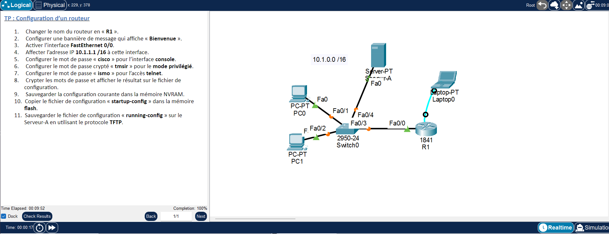

# TP1 - Configuration de base d'un routeur Cisco
  

## 🎯 Objectif

Configurer un routeur Cisco 1841 (R1) : nom, bannière, interface, mots de passe (console, telnet, mode privilégié), chiffrement, sauvegarde NVRAM / flash / TFTP.

## 🗺️ Topologie



## 📚 Notions mises en œuvre

- Modes IOS (user, privilege, configuration)
- Sécurisation des accès : console, VTY (Telnet), `enable secret`
- `service password-encryption`
- Gestion des fichiers : NVRAM, flash, serveur TFTP

## 🔌 Adressage des équipements

| Équipement | Interface | Adresse IP | Masque |
|---|---|---|---|
| R1 | FastEthernet0/0 | 10.1.1.1 | 255.255.0.0 |

## 📁 Contenu du dossier

| Fichier | Description |
|---|---|
| `lab.pka` | Fichier Cisco Packet Tracer (à ouvrir avec Packet Tracer) |
| `topologie.png` | Capture de l'énoncé et de la topologie |

## ▶️ Utilisation

1. Ouvrir le `.pka` avec Cisco Packet Tracer.
2. Ouvrir la CLI de chaque équipement et coller le bloc correspondant de `configuration.txt`.
3. Configurer les postes (IP statique ou DHCP) comme indiqué en fin de fichier.
4. Valider avec les commandes ci-dessous.

## ✅ Vérifications

```
show running-config
show startup-config
show flash:
show ip interface brief
ping 10.1.1.2 (depuis le routeur vers Serveur-A)
```

## 📝 Remarques

- Les adresses appliquent les règles de l'énoncé ; vérifier le brassage dans le `.pka` avec `show ip interface brief` / `show cdp neighbors`.
- Les adresses des PC/serveur ne sont pas imposées par l'énoncé visible : l'exemple utilise 10.1.1.x/16.

---

[⬅️ Retour à l'index des TP](../README.md)
