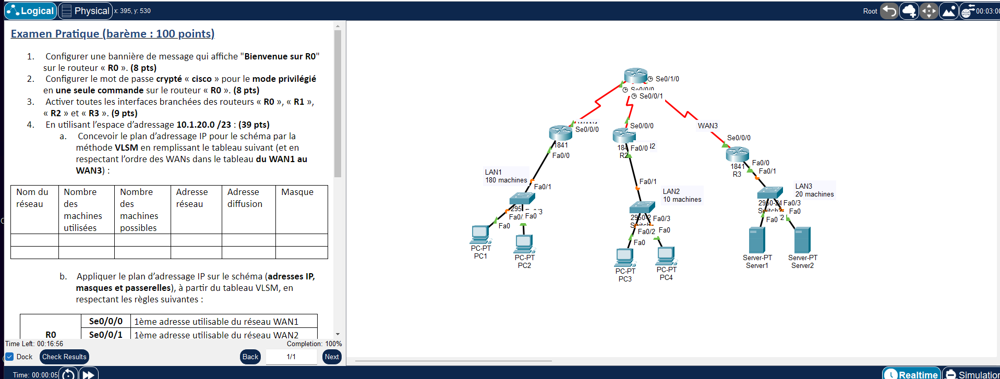

# TP2 - Routage statique et plan d'adressage VLSM
  

## 🎯 Objectif

Concevoir un plan d'adressage VLSM sur 10.1.20.0/23, interconnecter 3 LAN autour d'un routeur central (R0) par routage statique, sauvegarder les configurations (NVRAM) et exporter celle de R0 vers Server1 par TFTP.

## 🗺️ Topologie



## 📚 Notions mises en œuvre

- Découpage VLSM (tri par taille décroissante)
- Interfaces série, `clock rate` côté DCE
- Routes statiques sur R0 (interfaces de sortie)
- Routes par défaut sur R1, R2 et R3
- Bannière MOTD et `enable secret`
- Sauvegarde NVRAM et TFTP

## 🧮 Plan d'adressage VLSM

Les réseaux sont triés par taille décroissante, puis les WAN dans l'ordre WAN1 → WAN3.

| Réseau | Machines utilisées | Machines possibles | Adresse réseau | Diffusion | Masque |
|---|---|---|---|---|---|
| LAN1 | 180 | 254 | 10.1.20.0/24 | 10.1.20.255 | 255.255.255.0 |
| LAN3 | 20 | 30 | 10.1.21.0/27 | 10.1.21.31 | 255.255.255.224 |
| LAN2 | 10 | 14 | 10.1.21.32/28 | 10.1.21.47 | 255.255.255.240 |
| WAN1 | 2 | 2 | 10.1.21.48/30 | 10.1.21.51 | 255.255.255.252 |
| WAN2 | 2 | 2 | 10.1.21.52/30 | 10.1.21.55 | 255.255.255.252 |
| WAN3 | 2 | 2 | 10.1.21.56/30 | 10.1.21.59 | 255.255.255.252 |

## 🔌 Adressage des équipements

| Équipement | Interface | Adresse IP | Masque |
|---|---|---|---|
| R0 | Serial0/0/0 | 10.1.21.49 | 255.255.255.252 |
| R0 | Serial0/0/1 | 10.1.21.53 | 255.255.255.252 |
| R0 | Serial0/1/0 | 10.1.21.57 | 255.255.255.252 |
| R1 | FastEthernet0/0 | 10.1.20.1 | 255.255.255.0 |
| R1 | Serial0/0/0 | 10.1.21.50 | 255.255.255.252 |
| R2 | FastEthernet0/0 | 10.1.21.33 | 255.255.255.240 |
| R2 | Serial0/0/0 | 10.1.21.54 | 255.255.255.252 |
| R3 | FastEthernet0/0 | 10.1.21.1 | 255.255.255.224 |
| R3 | Serial0/0/0 | 10.1.21.58 | 255.255.255.252 |

| Équipement | Adresse IP | Masque | Passerelle |
|---|---|---|---|
| PC1 | 10.1.20.2 | 255.255.255.0 | 10.1.20.1 |
| PC3 | 10.1.21.34 | 255.255.255.240 | 10.1.21.33 |
| Server1 | 10.1.21.2 | 255.255.255.224 | 10.1.21.1 |

## 📁 Contenu du dossier

| Fichier | Description |
|---|---|
| `lab.pka` | Fichier Cisco Packet Tracer (à ouvrir avec Packet Tracer) |
| `topologie.png` | Capture de l'énoncé et de la topologie |

## ▶️ Utilisation

1. Ouvrir le `.pka` avec Cisco Packet Tracer.
2. Ouvrir la CLI de chaque équipement et coller le bloc correspondant de `configuration.txt`.
3. Configurer les postes (IP statique ou DHCP) comme indiqué en fin de fichier.
4. Valider avec les commandes ci-dessous.

## ✅ Vérifications

```
show ip route
show ip interface brief
ping entre PC1 (LAN1), PC3 (LAN2) et Server1 (LAN3)
show startup-config
```

## 📝 Remarques

- Les adresses appliquent les règles de l'énoncé ; vérifier le brassage dans le `.pka` avec `show ip interface brief` / `show cdp neighbors`.

---

[⬅️ Retour à l'index des TP](../README.md)
