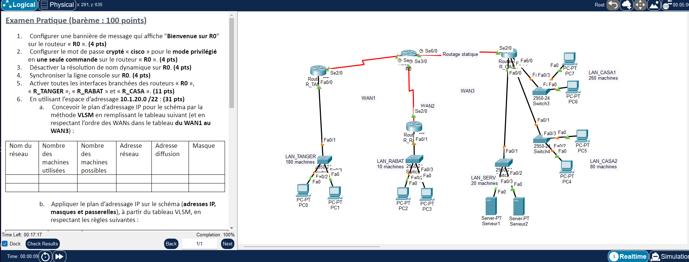

# TP3 - Routage statique, VLSM et DHCP
  

## 🎯 Objectif

Plan VLSM sur 10.1.20.0/22 pour 5 LAN et 3 WAN, routage statique par routes par défaut (distance administrative 30) entre 4 routeurs, et DHCP sur R_CASA.

## 🗺️ Topologie



## 📚 Notions mises en œuvre

- VLSM avec 5 LAN + 3 WAN
- Routes par défaut via l'interface de sortie
- Distance administrative des routes statiques (30)
- `no ip domain-lookup`, `logging synchronous`
- Pools DHCP et `ip dhcp excluded-address`

## 🧮 Plan d'adressage VLSM

Les réseaux sont triés par taille décroissante, puis les WAN dans l'ordre WAN1 → WAN3.

| Réseau | Machines utilisées | Machines possibles | Adresse réseau | Diffusion | Masque |
|---|---|---|---|---|---|
| LAN_CASA1 | 260 | 510 | 10.1.20.0/23 | 10.1.21.255 | 255.255.254.0 |
| LAN_TANGER | 180 | 254 | 10.1.22.0/24 | 10.1.22.255 | 255.255.255.0 |
| LAN_CASA2 | 80 | 126 | 10.1.23.0/25 | 10.1.23.127 | 255.255.255.128 |
| LAN_SERV | 20 | 30 | 10.1.23.128/27 | 10.1.23.159 | 255.255.255.224 |
| LAN_RABAT | 10 | 14 | 10.1.23.160/28 | 10.1.23.175 | 255.255.255.240 |
| WAN1 | 2 | 2 | 10.1.23.176/30 | 10.1.23.179 | 255.255.255.252 |
| WAN2 | 2 | 2 | 10.1.23.180/30 | 10.1.23.183 | 255.255.255.252 |
| WAN3 | 2 | 2 | 10.1.23.184/30 | 10.1.23.187 | 255.255.255.252 |

## 🔌 Adressage des équipements

| Équipement | Interface | Adresse IP | Masque |
|---|---|---|---|
| R0 | Serial2/0 | 10.1.23.177 | 255.255.255.252 |
| R0 | Serial3/0 | 10.1.23.181 | 255.255.255.252 |
| R0 | Serial6/0 | 10.1.23.185 | 255.255.255.252 |
| R_TANGER | FastEthernet0/0 | 10.1.22.1 | 255.255.255.0 |
| R_TANGER | Serial2/0 | 10.1.23.178 | 255.255.255.252 |
| R_RABAT | FastEthernet0/0 | 10.1.23.161 | 255.255.255.240 |
| R_RABAT | Serial2/0 | 10.1.23.182 | 255.255.255.252 |
| R_CASA | FastEthernet0/0 | 10.1.23.129 | 255.255.255.224 |
| R_CASA | FastEthernet1/0 | 10.1.23.1 | 255.255.255.128 |
| R_CASA | FastEthernet6/0 | 10.1.20.1 | 255.255.254.0 |
| R_CASA | Serial2/0 | 10.1.23.186 | 255.255.255.252 |

| Équipement | Adresse IP | Masque | Passerelle |
|---|---|---|---|
| PC1 | 10.1.22.2 | 255.255.255.0 | 10.1.22.1 |
| PC3 | 10.1.23.162 | 255.255.255.240 | 10.1.23.161 |
| Serveur1 | 10.1.23.130 | 255.255.255.224 | 10.1.23.129 |

## 📁 Contenu du dossier

| Fichier | Description |
|---|---|
| `lab.pka` | Fichier Cisco Packet Tracer (à ouvrir avec Packet Tracer) |
| `topologie.png` | Capture de l'énoncé et de la topologie |

## ▶️ Utilisation

1. Ouvrir le `.pka` avec Cisco Packet Tracer.
2. Ouvrir la CLI de chaque équipement et coller le bloc correspondant de `configuration.txt`.
3. Configurer les postes (IP statique ou DHCP) comme indiqué en fin de fichier.
4. Valider avec les commandes ci-dessous.

## ✅ Vérifications

```
show ip route
show ip dhcp pool
show ip dhcp binding
ipconfig /all (sur un PC en DHCP)
ping inter-LAN
```

## 📝 Remarques

- Les adresses appliquent les règles de l'énoncé ; vérifier le brassage dans le `.pka` avec `show ip interface brief` / `show cdp neighbors`.

---

[⬅️ Retour à l'index des TP](../README.md)
