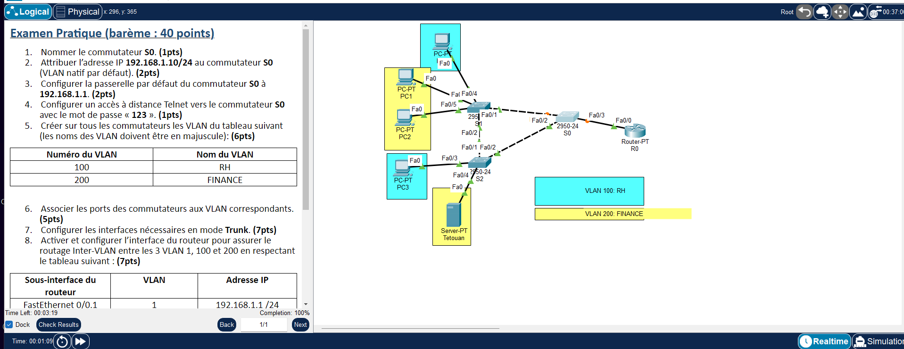
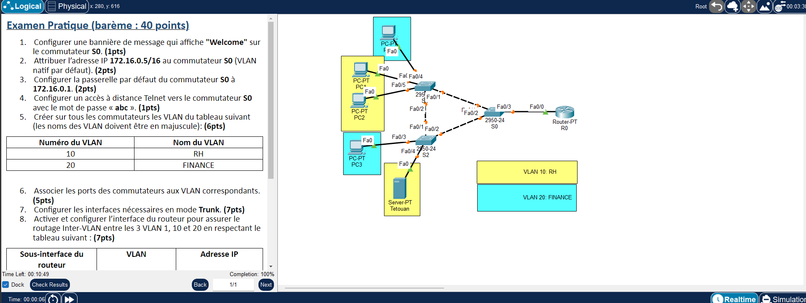

# TP4 - VLAN, trunk et routage inter-VLAN (router-on-a-stick)
  

## 🎯 Objectif

Configurer 3 commutateurs (S0, S1, S2) : VLAN nommés, ports d'accès, trunks, SVI de management avec accès Telnet, puis router 3 VLAN via des sous-interfaces sur R0. Deux variantes du même exercice (lab1 et lab2).

## 🗺️ Topologie





## 📚 Notions mises en œuvre

- Création et nommage de VLAN
- Ports `access` / `trunk`
- SVI de management + `ip default-gateway`
- Accès Telnet (`line vty 0 15`)
- Router-on-a-stick : sous-interfaces + `encapsulation dot1Q` (VLAN 1 natif)
- Adressage de masques variés (/8, /10, /12, /16, /24)

## 🔌 Adressage des équipements

**Lab1** — VLAN 1 : `192.168.1.10` (S0, passerelle `192.168.1.1`), VLAN 100 `RH`, VLAN 200 `FINANCE`

| Sous-interface R0 | VLAN | Adresse IP | Masque |
|---|---|---|---|
| FastEthernet0/0.1 | 1 | 192.168.1.1 | 255.255.255.0 |
| FastEthernet0/0.2 | 100 | 172.16.1.1 | 255.255.0.0 |
| FastEthernet0/0.3 | 200 | 10.1.1.1 | 255.240.0.0 |

| Équipement | Adresse IP | Masque | Passerelle |
|---|---|---|---|
| PC0 (VLAN 100) | 172.16.1.2 | 255.255.0.0 | 172.16.1.1 |
| PC1 (VLAN 200) | 10.1.1.2 | 255.240.0.0 | 10.1.1.1 |
| Tetouan (VLAN 200) | 10.1.1.10 | 255.240.0.0 | 10.1.1.1 |

**Lab2** — VLAN 1 : `172.16.0.5` (S0, passerelle `172.16.0.1`), VLAN 10 `RH`, VLAN 20 `FINANCE`

| Sous-interface R0 | VLAN | Adresse IP | Masque |
|---|---|---|---|
| FastEthernet0/0.1 | 1 | 172.16.0.1 | 255.255.0.0 |
| FastEthernet0/0.2 | 10 | 10.0.0.1 | 255.192.0.0 |
| FastEthernet0/0.3 | 20 | 20.1.1.1 | 255.0.0.0 |

| Équipement | Adresse IP | Masque | Passerelle |
|---|---|---|---|
| PC0 (VLAN 20) | 20.1.1.2 | 255.0.0.0 | 20.1.1.1 |
| PC1 (VLAN 10) | 10.1.1.3 | 255.192.0.0 | 10.0.0.1 |
| Tetouan (VLAN 10) | 10.1.1.100 | 255.192.0.0 | 10.0.0.1 |

## 📁 Contenu du dossier

| Fichier | Description |
|---|---|
| `lab1.pka` | Fichier Cisco Packet Tracer (à ouvrir avec Packet Tracer) |
| `lab2.pka` | Fichier Cisco Packet Tracer (à ouvrir avec Packet Tracer) |
| `topologie-lab1.png` | Capture de l'énoncé et de la topologie |
| `topologie-lab2.png` | Capture de l'énoncé et de la topologie |


## ▶️ Utilisation

1. Ouvrir le `.pka` avec Cisco Packet Tracer.
2. Ouvrir la CLI de chaque équipement et coller le bloc correspondant de `configuration-lab1.txt`.
3. Configurer les postes (IP statique ou DHCP) comme indiqué en fin de fichier.
4. Valider avec les commandes ci-dessous.

## ✅ Vérifications

```
show vlan brief
show interfaces trunk
show ip interface brief (R0)
ping entre machines de VLAN différents
telnet vers l'IP de S0
```

## 📝 Remarques

- Les adresses appliquent les règles de l'énoncé ; vérifier le brassage dans le `.pka` avec `show ip interface brief` / `show cdp neighbors`.

---

[⬅️ Retour à l'index des TP](../README.md)
