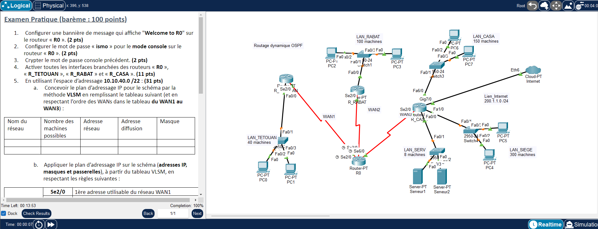

# TP5 - Routage dynamique OSPF (area 0)
  

## 🎯 Objectif

Plan VLSM sur 10.10.40.0/22 (5 LAN + 3 WAN), OSPF mono-aire (process-id 1, aire 0, distance administrative 70) entre 4 routeurs, route par défaut vers Internet sur R_CASA propagée par OSPF, et DHCP centralisé sur R_CASA avec relais sur R_TETOUAN.

## 🗺️ Topologie



## 📚 Notions mises en œuvre

- VLSM
- OSPF : `router ospf 1`, `network` + masque inverse, aire 0, `distance 70`
- Mot de passe console + `service password-encryption`
- Route par défaut (interface de sortie) + `default-information originate`
- DHCP centralisé sur R_CASA et relais DHCP (`ip helper-address`) sur R_TETOUAN

## 🧮 Plan d'adressage VLSM

Les réseaux sont triés par taille décroissante, puis les WAN dans l'ordre WAN1 → WAN3.

| Réseau | Machines utilisées | Machines possibles | Adresse réseau | Diffusion | Masque |
|---|---|---|---|---|---|
| LAN_SIEGE | 300 | 510 | 10.10.40.0/23 | 10.10.41.255 | 255.255.254.0 |
| LAN_CASA | 150 | 254 | 10.10.42.0/24 | 10.10.42.255 | 255.255.255.0 |
| LAN_RABAT | 100 | 126 | 10.10.43.0/25 | 10.10.43.127 | 255.255.255.128 |
| LAN_TETOUAN | 40 | 62 | 10.10.43.128/26 | 10.10.43.191 | 255.255.255.192 |
| LAN_SERV | 8 | 14 | 10.10.43.192/28 | 10.10.43.207 | 255.255.255.240 |
| WAN1 | 2 | 2 | 10.10.43.208/30 | 10.10.43.211 | 255.255.255.252 |
| WAN2 | 2 | 2 | 10.10.43.212/30 | 10.10.43.215 | 255.255.255.252 |
| WAN3 | 2 | 2 | 10.10.43.216/30 | 10.10.43.219 | 255.255.255.252 |

## 🔌 Adressage des équipements

| Équipement | Interface | Adresse IP | Masque |
|---|---|---|---|
| R0 | Serial2/0 | 10.10.43.209 | 255.255.255.252 |
| R0 | Serial3/0 | 10.10.43.213 | 255.255.255.252 |
| R0 | Serial6/0 | 10.10.43.217 | 255.255.255.252 |
| R_TETOUAN | FastEthernet0/0 | 10.10.43.129 | 255.255.255.192 |
| R_TETOUAN | Serial2/0 | 10.10.43.210 | 255.255.255.252 |
| R_RABAT | FastEthernet0/0 | 10.10.43.1 | 255.255.255.128 |
| R_RABAT | Serial2/0 | 10.10.43.214 | 255.255.255.252 |
| R_CASA | FastEthernet0/0 | 10.10.43.193 | 255.255.255.240 |
| R_CASA | FastEthernet1/0 | 10.10.40.1 | 255.255.254.0 |
| R_CASA | FastEthernet6/0 | 10.10.42.1 | 255.255.255.0 |
| R_CASA | GigabitEthernet7/0 | 200.1.1.1 | 255.255.255.0 |
| R_CASA | Serial2/0 | 10.10.43.218 | 255.255.255.252 |

| Équipement | Adresse IP | Masque | Passerelle |
|---|---|---|---|
| PC1 | 10.10.43.130 | 255.255.255.192 | 10.10.43.129 |
| PC3 | 10.10.43.2 | 255.255.255.128 | 10.10.43.1 |
| Serveur1 | 10.10.43.194 | 255.255.255.240 | 10.10.43.193 |

## 📁 Contenu du dossier

| Fichier | Description |
|---|---|
| `lab.pka` | Fichier Cisco Packet Tracer (à ouvrir avec Packet Tracer) |
| `topologie.png` | Capture de l'énoncé et de la topologie |

## ▶️ Utilisation

1. Ouvrir le `.pka` avec Cisco Packet Tracer.
2. Ouvrir la CLI de chaque équipement et coller le bloc correspondant de `configuration.txt`.
3. Configurer les postes (IP statique ou DHCP) comme indiqué en fin de fichier.
4. Valider avec les commandes ci-dessous.

## ✅ Vérifications

```
show ip ospf neighbor
show ip route ospf
show ip protocols
show ip dhcp binding (R_CASA)
ping entre LAN_TETOUAN, LAN_RABAT, LAN_CASA et LAN_SIEGE
show startup-config
```

## 📝 Remarques

- Les adresses appliquent les règles de l'énoncé ; vérifier le brassage dans le `.pka` avec `show ip interface brief` / `show cdp neighbors`.

---

[⬅️ Retour à l'index des TP](../README.md)
