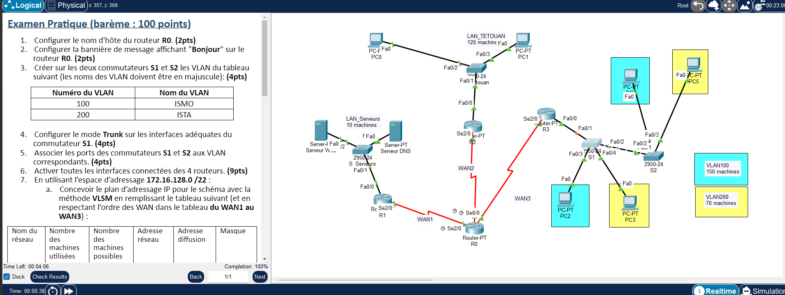

# TP6 - OSPF, VLAN et DHCP
  

## 🎯 Objectif

Plan VLSM sur 172.16.128.0/22, VLAN ISMO (100) / ISTA (200) sur deux commutateurs, routage inter-VLAN par sous-interfaces sur R3, OSPF (process-id 5, aire 0) entre 4 routeurs, SVI et Telnet sur S2.

## 🗺️ Topologie



## 📚 Notions mises en œuvre

- VLSM
- VLAN + trunk 802.1Q
- Router-on-a-stick (R3)
- OSPF process-id 5, aire 0
- SVI de management et Telnet sur S2
- DHCP sur R2 (adresse, masque, passerelle)
- Distance administrative OSPF 70

## 🧮 Plan d'adressage VLSM

Les réseaux sont triés par taille décroissante, puis les WAN dans l'ordre WAN1 → WAN3.

| Réseau | Machines utilisées | Machines possibles | Adresse réseau | Diffusion | Masque |
|---|---|---|---|---|---|
| VLAN100 | 150 | 254 | 172.16.128.0/24 | 172.16.128.255 | 255.255.255.0 |
| LAN_TETOUAN | 120 | 126 | 172.16.129.0/25 | 172.16.129.127 | 255.255.255.128 |
| VLAN200 | 70 | 126 | 172.16.129.128/25 | 172.16.129.255 | 255.255.255.128 |
| LAN_Serveurs | 10 | 14 | 172.16.130.0/28 | 172.16.130.15 | 255.255.255.240 |
| WAN1 | 2 | 2 | 172.16.130.16/30 | 172.16.130.19 | 255.255.255.252 |
| WAN2 | 2 | 2 | 172.16.130.20/30 | 172.16.130.23 | 255.255.255.252 |
| WAN3 | 2 | 2 | 172.16.130.24/30 | 172.16.130.27 | 255.255.255.252 |

## 🔌 Adressage des équipements

| Équipement | Interface | Adresse IP | Masque |
|---|---|---|---|
| R0 | Serial2/0 | 172.16.130.18 | 255.255.255.252 |
| R0 | Serial3/0 | 172.16.130.22 | 255.255.255.252 |
| R0 | Serial6/0 | 172.16.130.26 | 255.255.255.252 |
| R1 | FastEthernet0/0 | 172.16.130.1 | 255.255.255.240 |
| R1 | Serial2/0 | 172.16.130.17 | 255.255.255.252 |
| R2 | FastEthernet0/0 | 172.16.129.1 | 255.255.255.128 |
| R2 | Serial2/0 | 172.16.130.21 | 255.255.255.252 |
| R3 | FastEthernet0/0.1 | 172.16.128.1 | 255.255.255.0 |
| R3 | FastEthernet0/0.2 | 172.16.129.129 | 255.255.255.128 |
| R3 | Serial2/0 | 172.16.130.25 | 255.255.255.252 |

| Équipement | Adresse IP | Masque | Passerelle |
|---|---|---|---|
| PC0 | 172.16.129.126 | 255.255.255.128 | 172.16.129.1 |
| PC2 (VLAN100) | 172.16.128.254 | 255.255.255.0 | 172.16.128.1 |
| PC5 (VLAN200) | 172.16.129.254 | 255.255.255.128 | 172.16.129.129 |
| Serveur Web | 172.16.130.14 | 255.255.255.240 | 172.16.130.1 |
| S2 (SVI VLAN100) | 172.16.128.3 | 255.255.255.0 | 172.16.128.1 |

## 📁 Contenu du dossier

| Fichier | Description |
|---|---|
| `lab.pka` | Fichier Cisco Packet Tracer (à ouvrir avec Packet Tracer) |
| `topologie.png` | Capture de l'énoncé et de la topologie |

## ▶️ Utilisation

1. Ouvrir le `.pka` avec Cisco Packet Tracer.
2. Ouvrir la CLI de chaque équipement et coller le bloc correspondant de `configuration.txt`.
3. Configurer les postes (IP statique ou DHCP) comme indiqué en fin de fichier.
4. Valider avec les commandes ci-dessous.

## ✅ Vérifications

```
show vlan brief
show interfaces trunk
show ip ospf neighbor
show ip route ospf
show ip dhcp binding (R2)
telnet vers S2 (mot de passe abc)
ping PC VLAN100 <-> PC VLAN200 <-> LAN_Serveurs
```

## 📝 Remarques

- Les adresses appliquent les règles de l'énoncé ; vérifier le brassage dans le `.pka` avec `show ip interface brief` / `show cdp neighbors`.

---

[⬅️ Retour à l'index des TP](../README.md)
