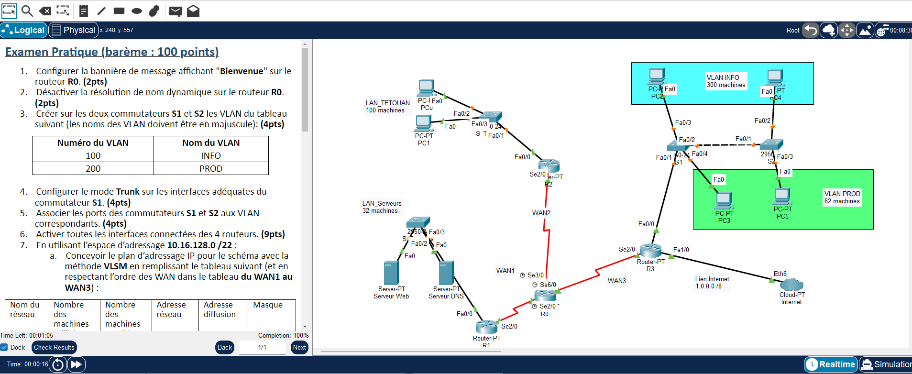
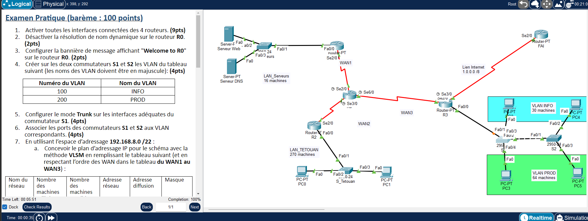

# TP7 - RIPv2, VLAN, DHCP et route par défaut vers Internet
  

## 🎯 Objectif

Même architecture (4 routeurs, 2 commutateurs, 2 VLAN INFO/PROD) avec routage RIPv2 (distance administrative 30 en lab1, 50 en lab2), interfaces passives, DHCP sur R2 et propagation d'une route par défaut vers Internet. Deux variantes : lab1 (10.16.128.0/22, Internet = cloud) et lab2 (192.168.8.0/22, routeur FAI avec route résumée).

## 🗺️ Topologie





## 📚 Notions mises en œuvre

- RIPv2 : `version 2`, `no auto-summary`, `distance 30` (lab1) / `distance 50` (lab2)
- Interfaces passives (`passive-interface`) vers les LAN
- Route par défaut statique (interface de sortie) + `default-information originate`
- Route résumée sur le routeur FAI (lab2, next-hop)
- Router-on-a-stick + VLAN INFO / PROD, SVI de management sur S2 + Telnet
- DHCP sur R2 (exclusions, passerelle, serveur DNS)
- VLSM

## 🧮 Plan d'adressage VLSM

Les réseaux sont triés par taille décroissante, puis les WAN dans l'ordre WAN1 → WAN3.

**Lab 1 - 10.16.128.0/22**

| Réseau | Machines utilisées | Machines possibles | Adresse réseau | Diffusion | Masque |
|---|---|---|---|---|---|
| VLAN INFO | 300 | 510 | 10.16.128.0/23 | 10.16.129.255 | 255.255.254.0 |
| LAN_TETOUAN | 100 | 126 | 10.16.130.0/25 | 10.16.130.127 | 255.255.255.128 |
| VLAN PROD | 62 | 62 | 10.16.130.128/26 | 10.16.130.191 | 255.255.255.192 |
| LAN_Serveurs | 32 | 62 | 10.16.130.192/26 | 10.16.130.255 | 255.255.255.192 |
| WAN1 | 2 | 2 | 10.16.131.0/30 | 10.16.131.3 | 255.255.255.252 |
| WAN2 | 2 | 2 | 10.16.131.4/30 | 10.16.131.7 | 255.255.255.252 |
| WAN3 | 2 | 2 | 10.16.131.8/30 | 10.16.131.11 | 255.255.255.252 |

**Lab 2 - 192.168.8.0/22**

| Réseau | Machines utilisées | Machines possibles | Adresse réseau | Diffusion | Masque |
|---|---|---|---|---|---|
| LAN_TETOUAN | 270 | 510 | 192.168.8.0/23 | 192.168.9.255 | 255.255.254.0 |
| VLAN PROD | 64 | 126 | 192.168.10.0/25 | 192.168.10.127 | 255.255.255.128 |
| VLAN INFO | 30 | 30 | 192.168.10.128/27 | 192.168.10.159 | 255.255.255.224 |
| LAN_Serveurs | 16 | 30 | 192.168.10.160/27 | 192.168.10.191 | 255.255.255.224 |
| WAN1 | 2 | 2 | 192.168.10.192/30 | 192.168.10.195 | 255.255.255.252 |
| WAN2 | 2 | 2 | 192.168.10.196/30 | 192.168.10.199 | 255.255.255.252 |
| WAN3 | 2 | 2 | 192.168.10.200/30 | 192.168.10.203 | 255.255.255.252 |

## 🔌 Adressage des équipements

**Lab 1**

| Équipement | Interface | Adresse IP | Masque |
|---|---|---|---|
| R0 | Serial2/0 | 10.16.131.2 | 255.255.255.252 |
| R0 | Serial3/0 | 10.16.131.6 | 255.255.255.252 |
| R0 | Serial6/0 | 10.16.131.10 | 255.255.255.252 |
| R1 | FastEthernet0/0 | 10.16.130.193 | 255.255.255.192 |
| R1 | Serial2/0 | 10.16.131.1 | 255.255.255.252 |
| R2 | FastEthernet0/0 | 10.16.130.1 | 255.255.255.128 |
| R2 | Serial2/0 | 10.16.131.5 | 255.255.255.252 |
| R3 | Serial2/0 | 10.16.131.9 | 255.255.255.252 |
| R3 | FastEthernet0/0.1 | 10.16.128.1 | 255.255.254.0 |
| R3 | FastEthernet0/0.2 | 10.16.130.129 | 255.255.255.192 |
| R3 | FastEthernet1/0 | 1.0.0.1 | 255.0.0.0 |

| Équipement | Adresse IP | Masque | Passerelle |
|---|---|---|---|
| PC0 | 10.16.130.126 | 255.255.255.128 | 10.16.130.1 |
| PC2 (VLAN INFO) | 10.16.129.254 | 255.255.254.0 | 10.16.128.1 |
| PC5 (VLAN PROD) | 10.16.130.190 | 255.255.255.192 | 10.16.130.129 |
| Serveur DNS | 10.16.130.254 | 255.255.255.192 | 10.16.130.193 |
| S2 (SVI VLAN 200) | 10.16.130.130 | 255.255.255.192 | 10.16.130.129 |

**Lab 2**

| Équipement | Interface | Adresse IP | Masque |
|---|---|---|---|
| R0 | Serial2/0 | 192.168.10.194 | 255.255.255.252 |
| R0 | Serial3/0 | 192.168.10.198 | 255.255.255.252 |
| R0 | Serial6/0 | 192.168.10.202 | 255.255.255.252 |
| R1 | FastEthernet0/0 | 192.168.10.161 | 255.255.255.224 |
| R1 | Serial2/0 | 192.168.10.193 | 255.255.255.252 |
| R2 | FastEthernet0/0 | 192.168.8.1 | 255.255.254.0 |
| R2 | Serial2/0 | 192.168.10.197 | 255.255.255.252 |
| R3 | Serial2/0 | 192.168.10.201 | 255.255.255.252 |
| R3 | FastEthernet0/0.10 | 192.168.10.129 | 255.255.255.224 |
| R3 | FastEthernet0/0.20 | 192.168.10.1 | 255.255.255.128 |
| R3 | Serial3/0 | 1.0.0.1 | 255.0.0.0 |
| FAI | Serial2/0 | 1.0.0.2 | 255.0.0.0 |

| Équipement | Adresse IP | Masque | Passerelle |
|---|---|---|---|
| PC0 | 192.168.9.254 | 255.255.254.0 | 192.168.8.1 |
| PC2 (VLAN INFO) | 192.168.10.158 | 255.255.255.224 | 192.168.10.129 |
| PC5 (VLAN PROD) | 192.168.10.126 | 255.255.255.128 | 192.168.10.1 |
| Serveur DNS | 192.168.10.190 | 255.255.255.224 | 192.168.10.161 |
| S2 (SVI VLAN 200) | 192.168.10.2 | 255.255.255.128 | 192.168.10.1 |

## 📁 Contenu du dossier

| Fichier | Description |
|---|---|
| `lab1.pka` | Fichier Cisco Packet Tracer (à ouvrir avec Packet Tracer) |
| `lab2.pka` | Fichier Cisco Packet Tracer (à ouvrir avec Packet Tracer) |
| `topologie-lab1.png` | Capture de l'énoncé et de la topologie |
| `topologie-lab2.png` | Capture de l'énoncé et de la topologie |


## ▶️ Utilisation

1. Ouvrir le `.pka` avec Cisco Packet Tracer.
2. Ouvrir la CLI de chaque équipement et coller le bloc correspondant de `configuration-lab1.txt`.
3. Configurer les postes (IP statique ou DHCP) comme indiqué en fin de fichier.
4. Valider avec les commandes ci-dessous.

## ✅ Vérifications

```
show ip route rip
show ip protocols
show vlan brief
show interfaces trunk
show ip dhcp binding
telnet vers S2 (mot de passe cisco)
ping vers Internet depuis un PC
```

## 📝 Remarques

- Les adresses appliquent les règles de l'énoncé ; vérifier le brassage dans le `.pka` avec `show ip interface brief` / `show cdp neighbors`.

---

[⬅️ Retour à l'index des TP](../README.md)
