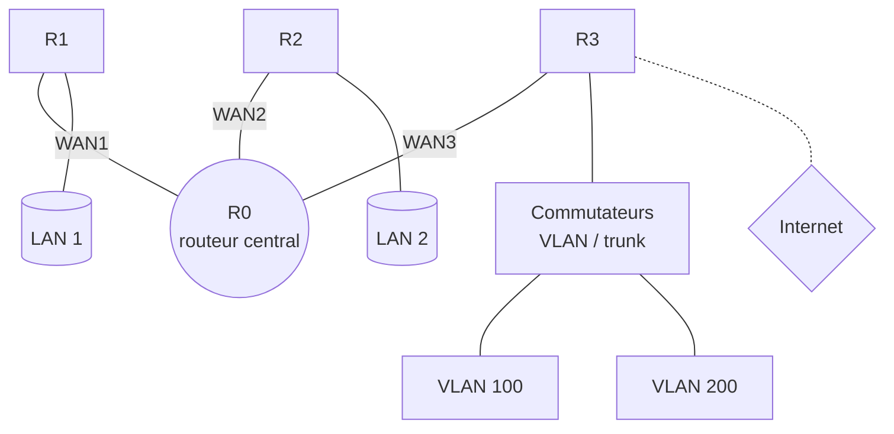

<div align="center">

# 🌐 Network Administration Labs

### Travaux pratiques d'administration réseaux avec Cisco Packet Tracer

    

**VLSM · VLAN · Routage statique · OSPF · RIPv2 · DHCP**

</div>

---

## 📖 Sommaire

- [À propos](#-à-propos)
- [Compétences démontrées](#-compétences-démontrées)
- [Liste des TP](#-liste-des-tp)
- [Architecture type](#-architecture-type)
- [Structure du dépôt](#-structure-du-dépôt)
- [Utilisation](#-utilisation)
- [Aide-mémoire](#-aide-mémoire)
- [Auteur](#-auteur)

## 🎯 À propos

Ce dépôt rassemble **7 groupes de TP (10 labs)** réalisés lors de ma préparation aux examens pratiques en administration réseaux. Chaque TP comprend :

- 📦 le fichier **Packet Tracer** (`.pka`) ;
- 🖼️ la **capture** de l'énoncé et de la topologie ;
- ⌨️ la **configuration IOS** (`configuration.txt`), prête à copier-coller ;
- 📝 un **README** détaillé : objectif, plan d'adressage VLSM, vérifications.

## 🧰 Compétences démontrées

| Domaine | Détail |
|---|---|
| 🔐 **Sécurisation** | Mots de passe console / VTY, `enable secret`, chiffrement, bannière MOTD |
| 🧮 **Adressage** | Conception de plans **VLSM** (IPv4) |
| 🔀 **Commutation** | VLAN, ports access / trunk, SVI de management, Telnet |
| 🛣️ **Routage** | Statique, par défaut, **OSPF**, **RIPv2**, inter-VLAN (*router-on-a-stick*) |
| 📡 **Services** | **DHCP** sur routeur (pools, exclusions, DNS) |
| 💾 **Gestion** | Sauvegarde NVRAM / flash / **TFTP** |
| 🔍 **Dépannage** | `show`, `ping`, `tracert` |

## 📚 Liste des TP

| N° | Dossier | Titre | Thèmes | Contenu |
|:-:|---|---|---|:-:|
| **01** | [`01-router-configuration`](./01-router-configuration) | Configuration de base d'un routeur Cisco | Routeur · IOS · TFTP | 1 lab |
| **02** | [`02-static-routing`](./02-static-routing) | Routage statique et plan d'adressage VLSM | Routage statique · VLSM | 1 lab |
| **03** | [`03-static-routing-dhcp`](./03-static-routing-dhcp) | Routage statique, VLSM et DHCP | Statique + DHCP · VLSM | 1 lab |
| **04** | [`04-vlan-switching`](./04-vlan-switching) | VLAN, trunk et routage inter-VLAN (router-on-a-stick) | VLAN · Trunk · Inter-VLAN | 2 variantes |
| **05** | [`05-ospf-routing`](./05-ospf-routing) | Routage dynamique OSPF (area 0) | OSPF · VLSM | 1 lab |
| **06** | [`06-ospf-vlan-dhcp`](./06-ospf-vlan-dhcp) | OSPF, VLAN et DHCP | OSPF + VLAN · DHCP | 1 lab |
| **07** | [`07-rip-vlan-dhcp-default-route`](./07-rip-vlan-dhcp-default-route) | RIPv2, VLAN, DHCP et route par défaut vers Internet | RIPv2 · Route par défaut · DHCP | 2 variantes |

## 🏗️ Architecture type

La plupart des TP suivent ce modèle : un routeur central (**R0**) relie des routeurs périphériques, chacun desservant un ou plusieurs LAN.



## 🗂️ Structure du dépôt

```text
network-administration-labs/
├── README.md
├── docs/
│   └── commandes.pdf              # aide-mémoire des commandes IOS
├── 01-router-configuration/
├── 02-static-routing/
├── 03-static-routing-dhcp/
├── 04-vlan-switching/                   # lab1 + lab2
├── 05-ospf-routing/
├── 06-ospf-vlan-dhcp/
└── 07-rip-vlan-dhcp-default-route/      # lab1 + lab2
    ├── README.md
    ├── lab1.pka · lab2.pka
    └── topologie-lab1.png · topologie-lab2.png
```

## ▶️ Utilisation

1. Installer [Cisco Packet Tracer](https://www.netacad.com/) (compte Networking Academy gratuit).
2. Ouvrir le fichier `.pka` du TP choisi.
3. Lire le `README.md` du TP (objectif, plan d'adressage).
4. Coller les commandes de `configuration.txt` dans la CLI de chaque équipement.
5. Valider avec les commandes de vérification indiquées.

## 📘 Aide-mémoire

Toutes les commandes utilisées sont regroupées dans [`Commandes.pdf`](./Commandes.pdf) : configuration initiale, interfaces, VLAN, routage, DHCP et gestion des fichiers.

## 👤 Auteur

**Asmae Abakouy** — Élève ingénieure en Génie Logiciel, ENSA Al Hoceima

*Projet réalisé dans le cadre du module Administration des réseaux et systèmes.*